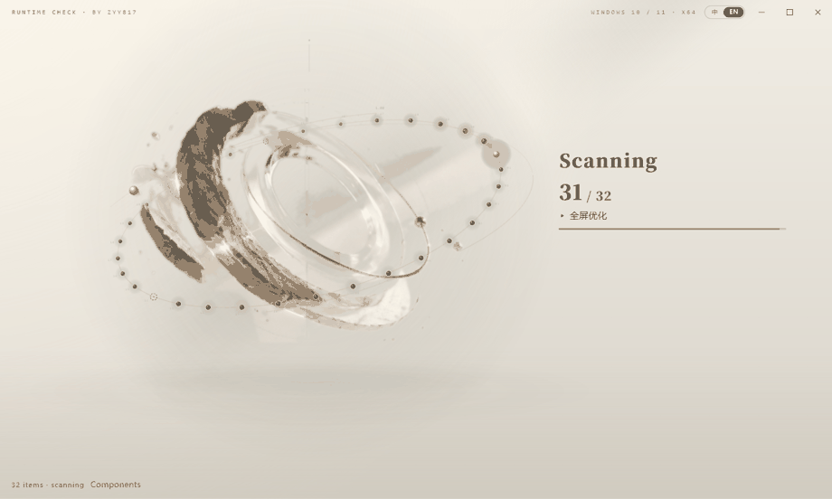
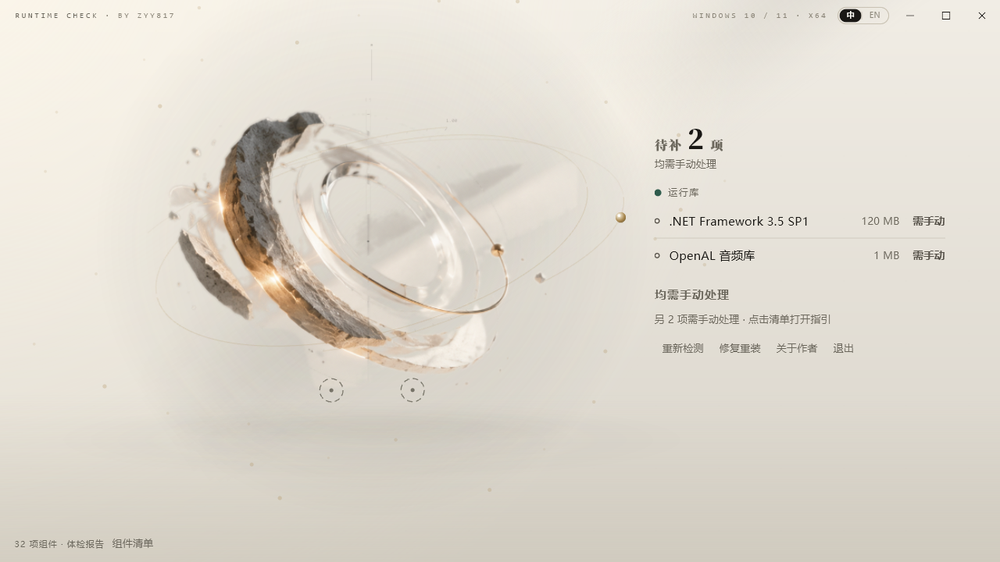
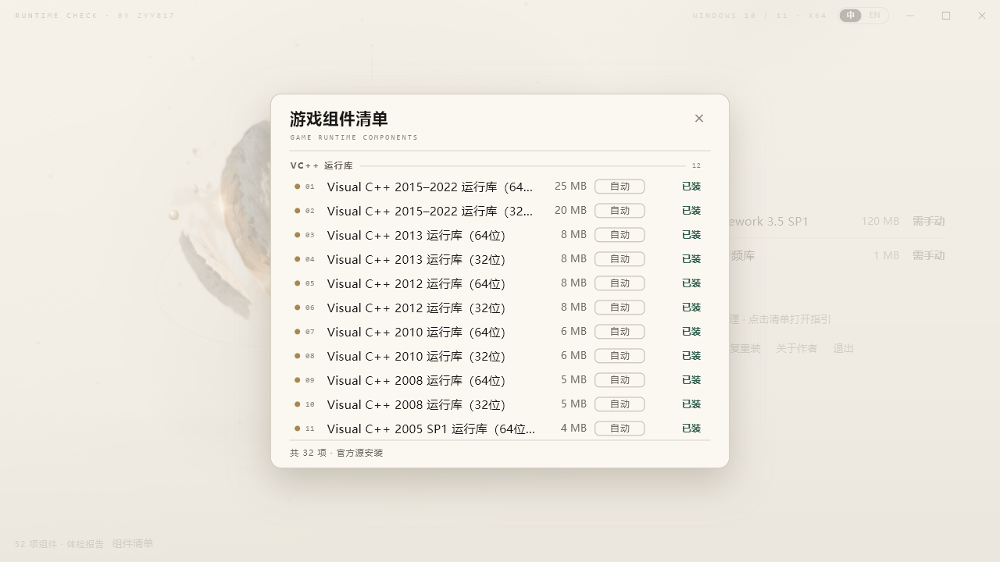

# wanji_kit · 玩机装机工具

> 游戏打不开？多半是缺运行库。

Windows 游戏运行环境一键检测与安装工具。扫一遍就知道缺什么、点一下就自动装齐——全部走微软 / 官方渠道，不碰任何第三方打包站。

Flutter Windows 桌面应用，奶油雕塑风格单窗口 UI。



## 它能做什么

- **体检**：32 项检测——VC++ 2005–2022、.NET Framework 3.5/4.8、.NET Desktop 6/8/9、DirectX Jun 2010、XNA、OpenAL、PhysX、WebView2、Java、UE4 前置组件等运行库，外加 DirectPlay、游戏模式、GPU 硬件加速调度、高性能电源等系统优化项（可勾选跳过）
- **一键装齐**：缺失项自动排队 → 一次 UAC 提权 → winget 优先、官方直链兜底 → 装完逐项重扫验证
- **修复模式**：已装但疑似损坏的运行库，勾上强制重装
- **装不了的给路**：无自动渠道的组件标「需手动」，点开直达官方指引；自动安装失败的项在完成页给出官方下载链接，不留死路
- **没 winget 也能用**：所有 winget 组件都配了微软官方直链兜底，老系统 / 精简系统照装
- **双语**：中文 / English 界面一键切换





## 下载

👉 [Releases](https://github.com/ZYY817/wanji-kit/releases) 下载 `wanji-kit-v*-windows-x64.zip`，解压整目录即用。

- Windows 10 / 11 x64，免安装绿色软件
- 首次运行 SmartScreen 提示属正常（未做代码签名）：更多信息 → 仍要运行
- `catalog\runtimes.json` 放 exe 同级即可热更新组件库，不用重编

## 从源码构建

环境：Flutter SDK（stable，Windows 桌面支持）+ Visual Studio Build Tools（C++ 负载）

```bash
cd app
flutter pub get
flutter analyze                  # 零 issue
flutter run -d windows           # 调试运行
flutter build windows --release  # 产出 → app\build\windows\x64\runner\Release\
```

打包发布（release 构建 → 自动补齐 VC++ CRT dll → 打 zip）：

```powershell
powershell -File scripts/package.ps1 -Version 0.3
powershell -File scripts/package.ps1 -Version 0.3 -SkipBuild   # 用现有 Release\ 直接打
```

## 调试参数

```
runtime_check.exe --autoscan       # 启动后自动开扫（真实检测）
runtime_check.exe --demo-report    # 假数据直进结果屏（视觉自查）
runtime_check.exe --demo-install   # 假数据走完整安装动画，不写系统
runtime_check.exe --install=a,b,c  # 提权续装（内部由 UAC 重启调用）
```

## 目录结构

```
catalog/runtimes.json     组件目录——新增组件 = 加一条 JSON，不写代码
app/lib/engine/           catalog / detect / install / elevate / log 引擎
app/lib/ui/               雕塑舞台(sculpt) + 轨道粒子模型(orb) + HUD
app/windows/runner/       Win32 宿主：无边框窗、NCHITTEST 拖拽/缩放、自适应默认尺寸
scripts/                  package.ps1 打包 / check_catalog.dart 目录校验 / 截图调试工具
docs/                     产品规划、界面截图
```

## 实现要点

- **catalog 驱动**：32 项组件全部由 JSON 数据描述（检测规则 + 安装渠道 + 官方链接），扩组件不改代码
- **安装链路**：winget → 官方直链 → 手动指引三级兜底；winget 装完仍逐项重扫验证，报成功不算数、扫到才算数
- **提权**：安装时自我 UAC 重启（`--install=` 续装），日志落 `%APPDATA%\WanjiKit\logs\`
- **性能**：雕塑层预烘位图、粒子对象池、最小化自动停帧（实测最小化 CPU ≈0.3%）

## 路线图

- v0.1：扫描 + 报告 + 一键装齐 + 日志 ✅
- v0.2/v0.3（当前）：无边框窗、双语、修复模式、32 项目录、系统优化项、官方链接兜底 ✅
- 后续：按游戏体检（联动玩机索引站数据）、catalog 在线热更、离线安装包、CLI 输出

## 已知限制

- 检测是存在性判断：能验「装没装」，不验运行库内部是否损坏
- 手动项只给官方指引跳转，不代办系统操作（如 DirectPlay 走 Windows 可选功能）
- 未做代码签名，SmartScreen 会有提示

## 作者

**ZYY817 / Zhiyu（智宇）** · Applied AI

用 AI 创造，让想法真正产生价值。

[GitHub](https://github.com/ZYY817) · [Bilibili](https://space.bilibili.com/41173761)
